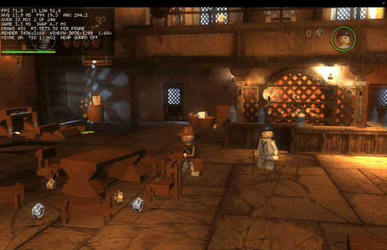

> [!IMPORTANT]
> This project does not include any game files. You need your own GOG copy of LEGO Indiana Jones: The Original Adventures (the Windows version).

<h1 align="center">
  
  <br>
  Indy Recompiled
</h1>

<p align="center">
  
  
  
</p>

<p align="center"><i>26-second video: <a href="docs/media/gameplay.mp4">gameplay.mp4</a>. Played on an M1 Max; the overlay shows about 100 to 115 FPS.</i></p>

LEGO Indiana Jones: The Original Adventures (Traveller's Tales, 2008) is sold on GOG as a Windows game. This project turns the game's Windows code into C and compiles it into a Mac app for Apple Silicon. It does not use Wine or an emulator. The game's Direct3D 9 graphics go through [DXVK](https://github.com/doitsujin/dxvk) to Vulkan, and [KosmicKrisp](https://docs.mesa3d.org/drivers/kosmickrisp.html) runs Vulkan on Metal.

The translator and the Windows support are [MacRecomp](https://github.com/itsdunintime104/MacRecomp). It also runs [Wizard Bricks Recompiled](https://github.com/itsdunintime104/WizardBrick-Recomp) (LEGO Harry Potter: Years 1-4), [Hobbit Recompiled](https://github.com/itsdunintime104/HobbitRecompiled) and [Superheros Bricks Recompiled](https://github.com/itsdunintime104/SuperheroBrickRecomp). This repo holds only what is particular to this game: the list of the game's functions, the build settings and the notes.

This project is not affiliated with or endorsed by TT Games, LucasArts, Lucasfilm, Disney or the LEGO Group.

## Contents

- [Requirements](#requirements)
- [Get the game files](#get-the-game-files)
- [Install](#install)
- [Playing](#playing)
- [Saves](#saves)
- [Status](#status)
- [Known issues](#known-issues)
- [Troubleshooting](#troubleshooting)
- [Building and development](#building-and-development)
- [Credits](#credits)
- [License](#license)

## Requirements

- A Mac with Apple Silicon (M1 or newer)
- LEGO Indiana Jones: The Original Adventures from GOG, Windows version
- Xcode Command Line Tools
- Homebrew with the packages listed in [Install](#install)
- Python 3.11 or newer
- About 3 GB of free disk space for the build, plus 3.6 GB for the game files

## Get the game files

The app needs the installed game folder: the one with `LEGOIndy.exe` and the `.DAT` files. Use one of these ways, with your own GOG licence:

1. **A Windows PC**: install the game with GOG and copy its folder to your Mac.
2. **GOG Galaxy inside Wine, CrossOver or Whisky**: `setup.sh` finds the game there.

Only one version of `LEGOIndy.exe` works: the one with SHA-256 checksum `6c72717abc5b38a44ec235540176c76a2778c1d8f0dd8889b714a12391e162d1`. `setup.sh` checks it.

## Install

1. Install the Xcode Command Line Tools, and wait until the installer says it is done:
   ```sh
   xcode-select --install
   ```
2. Install [Homebrew](https://brew.sh), then the tools:
   ```sh
   brew install sdl2 sdl3 faudio vulkan-loader vulkan-headers meson ninja pkgconf glslang \
       llvm spirv-llvm-translator spirv-tools zstd autoconf automake libtool bison flex mingw-w64 python
   ```
3. Get the code and run the setup script with your game folder:
   ```sh
   git clone --recurse-submodules https://github.com/itsdunintime104/IndyRecomp.git
   cd IndyRecomp
   ./setup.sh "$HOME/Games/LEGO Indiana Jones"
   ```
   Without a folder, setup looks in `~/Games`, GOG installs under Wine, CrossOver or Whisky, and external drives. If it finds nothing, it asks.
4. Open **LEGO Indiana Jones - The Original Adventures** from `~/Applications`.

`setup.sh` checks your Mac and builds the graphics libraries (about 4 minutes, the first time only). Then it copies the game's exe, checks it, translates it, builds the app and installs it. It never writes to the game folder.

Keep the cloned folder: the app reads the game's exe from `orig.nosync/` in it. The app remembers the game folder.

| Option | Effect |
|---|---|
| `--check` | Only check the requirements |
| `--force` | Translate again. Use it after `git pull` |
| `--no-install` | Build the app in `build.nosync/` without copying it to `~/Applications` |
| `--dry-run` | Print each step without running it |

## Playing

The game sees a controller, such as a DualShock 4, as an Xbox controller.

The app reads two settings from the environment: `INDYRECOMP_GAME_DIR` (the game folder, if you moved it after setup) and `INDYRECOMP_EXE` (another copy of the game's exe).

Each run writes a log to `~/Library/Logs/IndyRecomp/`. The app keeps the newest 20. Attach the log when you report a problem.

## Saves

The game writes its saves and settings to its Windows profile folder. The app keeps that folder in `~/Library/Application Support/IndyRecomp`. It never writes to the game folder. Shader caches are in `~/Library/Caches/IndyRecomp`.

> [!WARNING]
> Back up `~/Library/Application Support/IndyRecomp` before you play.

## Status

The game starts, shows its menus and plays, with sound. A DualShock 4 works. It was played by hand on 2026-10-26.

## Known issues

- The movies (the logos and the intro) are skipped. The runtime cannot play Bink video yet.
- Some textures with floating-point colours get only the smaller sizes stored in the file; the runtime does not make the missing ones.

## Troubleshooting

| Problem | Fix |
|---|---|
| "game folder not found" | Give the folder with `LEGOIndy.exe` to `setup.sh`, or set `INDYRECOMP_GAME_DIR` |
| `setup.sh` says the checksum does not match | Only the GOG version of `LEGOIndy.exe` works |
| macOS says the app is damaged | Build the app with `setup.sh` on your own Mac. A copy from another Mac does not run |

## Building and development

The build rules, the runtime, the tools and the tests are in the engine. [engine/windows/README.md](https://github.com/itsdunintime104/MacRecomp/blob/main/windows/README.md) describes the files this repo gives the engine (`build/Makefile`, `game.conf` and the game patches). After `setup.sh` has built the graphics libraries, you can build by hand:

```sh
make -C build -j8                 # build.nosync/indy
make -C build test                # the engine's tests
make -C build app GAME_DIR=<game folder>
engine/windows/tools/package/check_app.sh "build.nosync/LEGO Indiana Jones - The Original Adventures.app"
```

After a change to `recon/`, check that the translation still reaches every function the game can call. A clean run prints `findings 0`:

```sh
.venv/bin/python -I engine/windows/tools/pe/recon_check.py orig.nosync/LEGOIndy.exe --recon recon
```

| Path | Contents |
|---|---|
| `recon/` | what the translator needs to know about `LEGOIndy.exe`: its functions, added function starts, the C library start-up tables, names, switch tables and `entry_zf.json` (math functions that read a flag their caller set) |
| `runtime/src/` | this game's patches |
| `build/Makefile`, `game.conf`, `setup.sh` | the settings the engine's build and setup read |
| `notes/` | how the game was brought up |
| `engine/` | MacRecomp (git submodule) |

## Credits

- **[MacRecomp](https://github.com/itsdunintime104/MacRecomp)**: the translator and the runtime.
- **[xboxrecomp](https://github.com/sp00nznet/xboxrecomp)** by sp00nznet: the x86-to-C translator that MacRecomp's translator started from (MIT license).
- **[DXVK](https://github.com/doitsujin/dxvk)** (zlib license), with the macOS patches from [jm2/dxvk](https://github.com/jm2/dxvk): Direct3D 9 to Vulkan.
- **[vkd3d-shader](https://gitlab.winehq.org/wine/vkd3d)** (LGPL-2.1): translates the game's shaders.
- **[Mesa](https://mesa3d.org) KosmicKrisp** (MIT license): Vulkan on Metal.
- **[FAudio](https://github.com/FNA-XNA/FAudio)** (zlib license): the game's sound.
- **[SDL2](https://www.libsdl.org/)** (zlib license): window, keyboard and controllers.
- **[Capstone](https://www.capstone-engine.org/)** (BSD license): reads x86 instructions for the translator.

## License

GPL-3.0. See [LICENSE](LICENSE). Third-party code keeps its own license: see `engine/tools/xrecomp/LICENSE`, `engine/tools/xrecomp/NOTICE` and the header of `engine/runtime/src/dlmalloc.c`. The patches in `engine/windows/tools/` keep the license of the project they patch.

The repository contains no game files, no game exe and no code made from the game. `recon/` holds function addresses, import names and switch tables read from the game's exe, which the translator needs. The app icon is made from your own copy of the game when you build.
